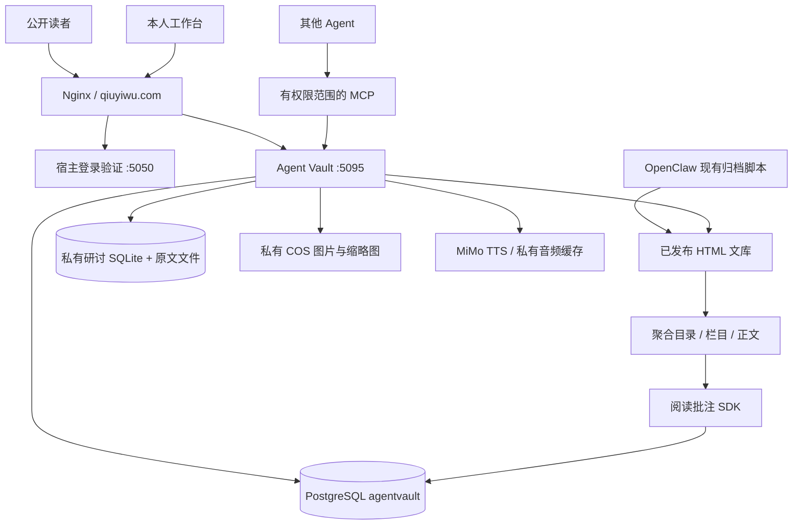

# 当前架构与能力边界

核实日期：2026-10-14。生产 agent-vault.service active，工作目录 /opt/agent-vault，运行身份 agentvault。生产目录未受 Git 管理；本次回收源码，未部署覆盖生产。公开目录111项：reading18、video9、books27、digest15、html40、seminar2。计数只代表公开目录，不含私有采集，也不是原始来源数量。

## 权威数据与归属

| 数据 | 当前正本 | 约束 |
|---|---|---|
| 已发布内容 | /var/www/html/vault 中HTML | 来源可能是旧OpenClaw或后台发布，不能声称全部来自同一结构化数据库 |
| 管理草稿与修订 | PostgreSQL documents/revisions/publications | 草稿与发布分离；发布检查线上哈希避免覆盖外部修改 |
| 阅读与批注 | knowledge 数据及 annotation 独立逻辑 | 两条笔记链路仍需统一映射，不能声称所有批注自动进入简报 |
| 图片采集 | COS原图/缩略图 + PostgreSQL元数据 | SHA去重、私有访问、临时签名；不进入公开目录 |
| Markdown笔记 | PostgreSQL zhuazhua notes | version冲突保护；未实现完整历史/回收站 |
| 研讨原始对话 | 独立SQLite及私有文件 | 追加幂等、冲突不覆盖；公开文章和原文权限分开 |
| 技能 | skills + integrations版本快照 + skill_registry | 仍有多处注册，需统一生成，避免版本漂移 |
| 源码 | 本地Git → GitHub | 生产当前无Git/发布SHA，下一步建设可复现发布 |

## 模块与入口

- production.py：HTTP入口、宿主登录、管理发布、公共目录、MCP权限；仍为较集中的路由文件。
- core/cli/admin/reader/migration：早期本地SQLite及迁移工具，与生产分开。
- knowledge/knowledge_mcp：正文索引、实体、资料包、简报、Agent查询；统计不是自动事实核验。
- annotations + sdk/annotation：划线和评注；私人数据不通过公开只读凭据暴露。
- seminar/seminar_sources/skill_registry：研讨质量契约、原始对话续存、技能发现。
- captures/notes/telemetry：私人图片、文字笔记、可选聚合体验指标。
- tts：MiMo合成与缓存；实际播放仍需听审。
- channel/web：公共频道、后台应用界面、主题和来源筛选。

## 已知边界

单人宿主登录，不是多租户。OpenDesign MCP往返编辑尚未闭环。采集笔记尚无完整历史与回收站。旧归档直写与新API仍共存。数据库、HTML、COS及私有对话存储尚没有统一恢复演练证据。可访问、代码存在、单元测试通过与真实端到端验收是不同状态。
