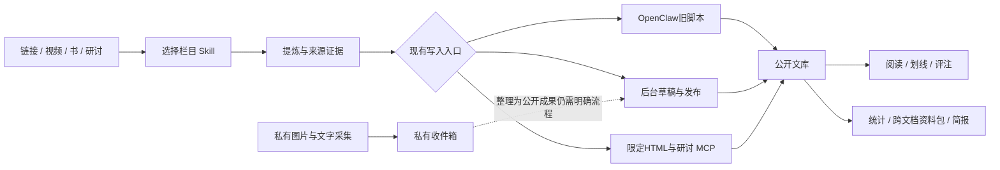

# 当前流程与下一步

更新：2026-10-14。下面区分现在可用的路径和建议建设项。

## 当前路径

## 按价值排序的优化计划

| 优先级 | 要解决的问题 | 最小交付 | 验收 |
|---|---|---|---|
| P0 | 线上与Git漂移 | GitHub源码正本、CI、发布manifest与回退指针 | 同一commit可构建；线上可查SHA；改动不靠直接覆盖 |
| P0 | 三条写入路径不一致 | 统一 ingest/validate/draft/publish 接口；旧脚本成为适配器 | 重试不重复、并发409、失败不丢、全目录不缺项 |
| P1 | 采集后不会整理 | 收件箱 → 待整理 → 已归档，来源与目标文档关联 | 一个截图/链接可追溯到成果，不自动公开私人材料 |
| P1 | 标准多处维护 | 一份栏目schema生成Skill字段说明、MCP校验和后台表单 | 改一次字段后三端一致；旧版本可读取 |
| P1 | 划线与简报脱节 | 稳定文档ID/修订/锚点；简报汇总新增、本人笔记、待追问问题 | 每个判断可回跳证据；无新增不凑日报 |
| P1 | 统计看起来相似但口径不同 | 人物/渠道归一与别名；次数、文章数、时间窗分开 | 点数字可查看构成文章；未知来源不猜 |
| P2 | 日报需手动启动 | 任务队列、日期幂等、生成状态、音频重试 | 文本先审阅；同一天不重复扣费；失败可补跑 |
| P2 | 多存储难恢复 | 数据库+HTML+COS引用+研讨源的备份清单与演练 | 在隔离环境恢复并抽样读写，不只验证备份文件存在 |

建议下一轮只做P0：先让代码版本和写入流程可靠，再扩展更多看板。先用现有单服务，不急于拆微服务。GitHub Actions第一阶段仅测试，不自动发布到共享生产机。

## 业务验收清单

1. 一篇微信文章和一条视频：导入、字段校验、重复重试、审核发布、首页/栏目/统计一致。
2. 同文档两个Agent并发修改：后写者收到冲突，原稿和双方草稿均保留。
3. 阅读划线并写评注，重新打开仍可定位；改版后不能定位时明确提示。
4. 私人截图转成成果：只有显式选中的内容公开，OCR/原图不被只读MCP意外读取。
5. 日报每条有来源、本人笔记单独标识、追问不伪装事实，完成实际音频试听。
