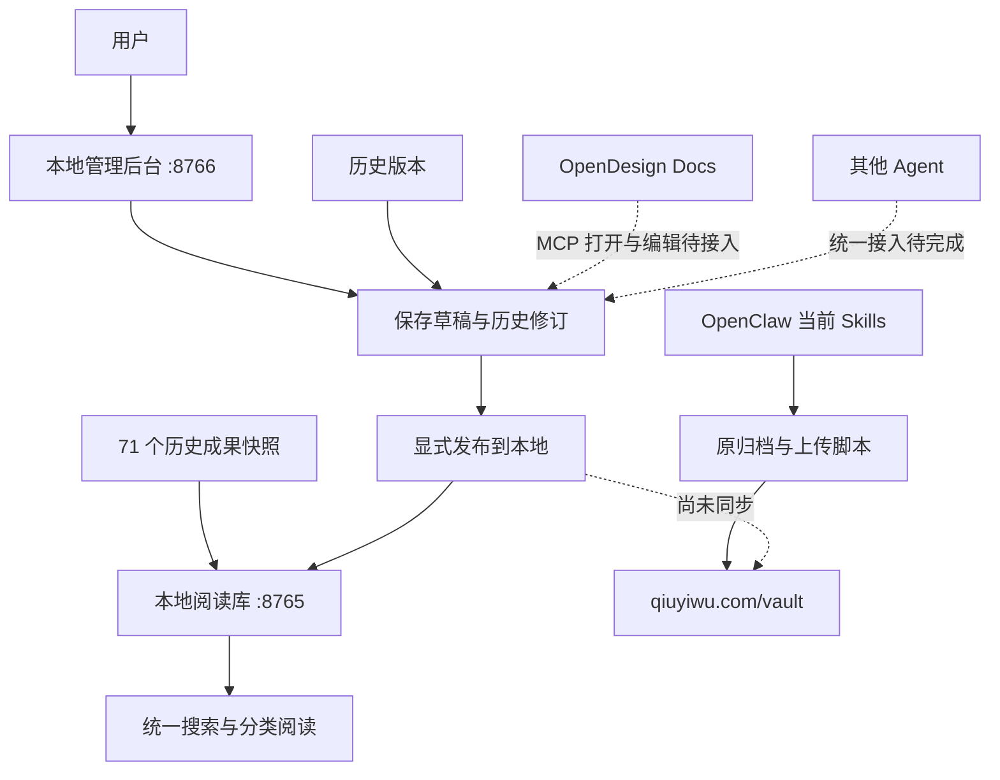

# 当前运行链路

实线代表已实现；虚线代表尚未接通。

日常使用：选择或新建成果，编辑，保存草稿，发布到本地，刷新阅读库。恢复历史时先载入版本，保存为新草稿再发布。重启使用 start-vault.command。

当前数据与页面都是本机版，未迁移现网后台。后台使用同一 SQLite 文件内的 managed 表；早期 CLI 的 strict v1 表不自动进入阅读版，不应宣称所有 Agent 已统一接入。
