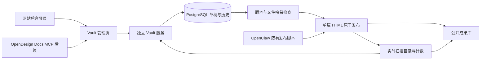

> 后续变更：阅读笔记、跨文章洞察、简报和只读 MCP 见 [2026-10-05 阅读与洞察](reading-intelligence.md)。下文为本日首次上线记录。

# Vault 生产运行记录 · 2026-10-05

管理入口：https://qiuyiwu.com/admin/vault/
阅读入口：https://qiuyiwu.com/vault/

已部署到用户授权的既有腾讯云服务器。管理入口沿用现有网站登录；服务器 SSH 账户不是网站登录账户。

## 当前链路

- 独立服务 `/opt/agent-vault`，systemd `agent-vault.service`，仅监听 `127.0.0.1:5095`。
- PostgreSQL 独立数据库与 peer 角色 `agentvault`，没有新增数据库密码。
- 公开文件沿用 `/var/www/html/vault`；草稿、历史、发布前字节保存在数据库，未放进公网目录。
- nginx 新增 `/etc/nginx/snippets/qiuyiwu-vault.conf`。注意此服务器 `sites-enabled/qiuyiwu.com` 是独立文件，不是 sites-available 的软链接；两个副本均加入 include。
- 工作台 `/admin/dashboard.html` 通过 nginx 增加 Vault 管理入口，不修改网站仓库中的原 dashboard。
- 原有 71 份成果按线上 HTML 正文导入；已有 Markdown 不当作与线上完全相同的源稿。
- 新建支持 Markdown 和 HTML；已有成果按 HTML 原文编辑。历史版本载入后另存草稿再发布。
- 公开目录直接扫描线上文件，新增成果会进入目录；后台可按标题查找。
- OpenClaw 旧脚本尚未改接新 API。无草稿时可扫描收录外部文件更新；有草稿发生外部变化时拒绝覆盖，需要人工合并。外部写入者未使用共同锁，不能承诺所有写入方绝对无竞态。
- OpenDesign Docs MCP、附件上传、独立 Agent 凭据和统一写入 SKILL、富文本 Markdown 编辑器均未上线。

## 验证证据

- 原有 17 个单元测试通过。
- `tests/production_acceptance.py` 在生产 PostgreSQL 的临时隔离 schema / 临时目录验证：历史导入、草稿隔离、发布、历史内容、旧版本拒绝、外部更改拒绝、实时目录、Markdown 与前端 URL。
- 真实数据库和文件目录完成一次原文不变的保存与发布，记录 `live-ac5b5d37f13e9f73d1614bcd` 从 v0 到 v1，发布前后文件 SHA-256 一致。
- 正式域名：阅读入口与目录返回 200，71 份；未登录后台跳转现有登录页；未登录管理 API 401；Markdown 源文件 404。
- 当前浏览器自动化加载超时，未完成登录后浏览器点击验收。不要把服务器端验证表述为浏览器验收。

## 备份与恢复

上线前归档 `/var/backups/agent-vault/20261005/pre-deploy.tar.gz`（root 600），含原 Vault、sites-available 配置、登录 nginx 片段、dashboard；实际生效的 nginx 文件另存为 `nginx-enabled.conf`。

回退入口：先保存当前配置副本，将 `nginx-enabled.conf` 恢复到 `/etc/nginx/sites-enabled/qiuyiwu.com`，执行 `nginx -t` 后 reload，原有静态首页即恢复。停止 `agent-vault.service`。此操作不删除 DB 草稿或历史。sites-available 中本次 include 也应移除以保持副本一致。不要把旧 Vault 归档整包覆盖回去，以免抹掉上线后的新增稿件。

数据库备份：`sudo -u postgres pg_dump -Fc agentvault`，输出应由 root 保存到非公开备份目录并设为 600。单篇内容恢复优先通过后台载入历史并保存为新版本后发布。

部署源保存在本项目 `src/agent_vault/production.py` 和 `deploy/`，不要把本地 prototype 的 SQLite 或旧 reader-site 同步到生产。
